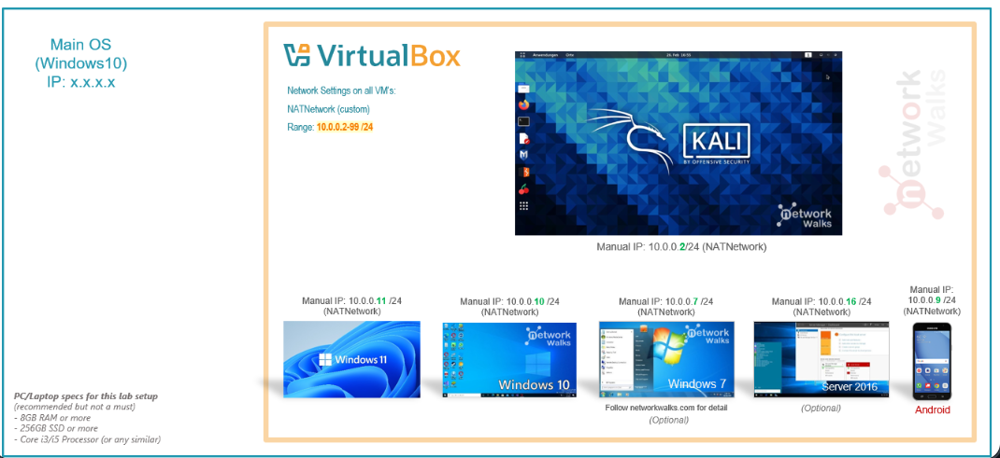
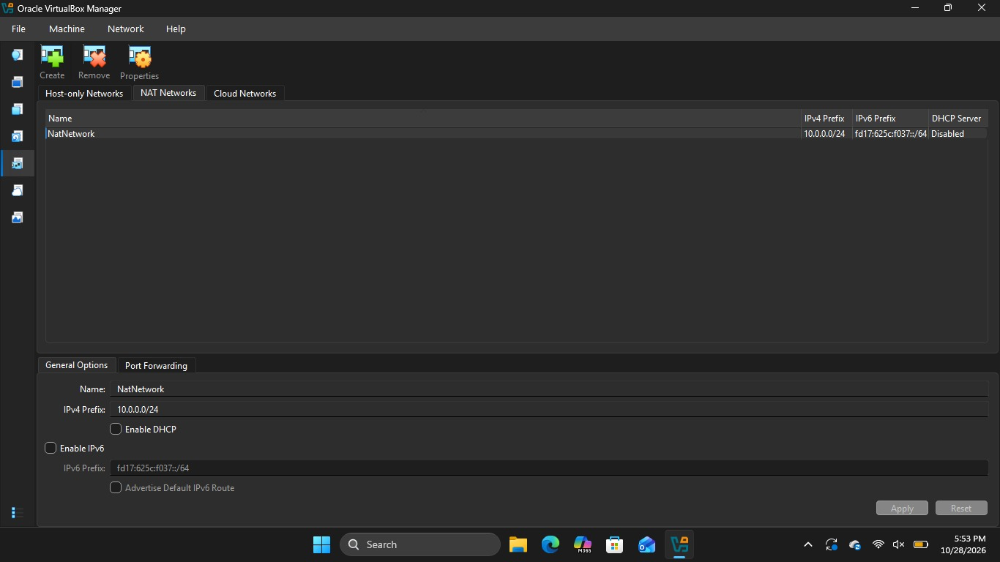
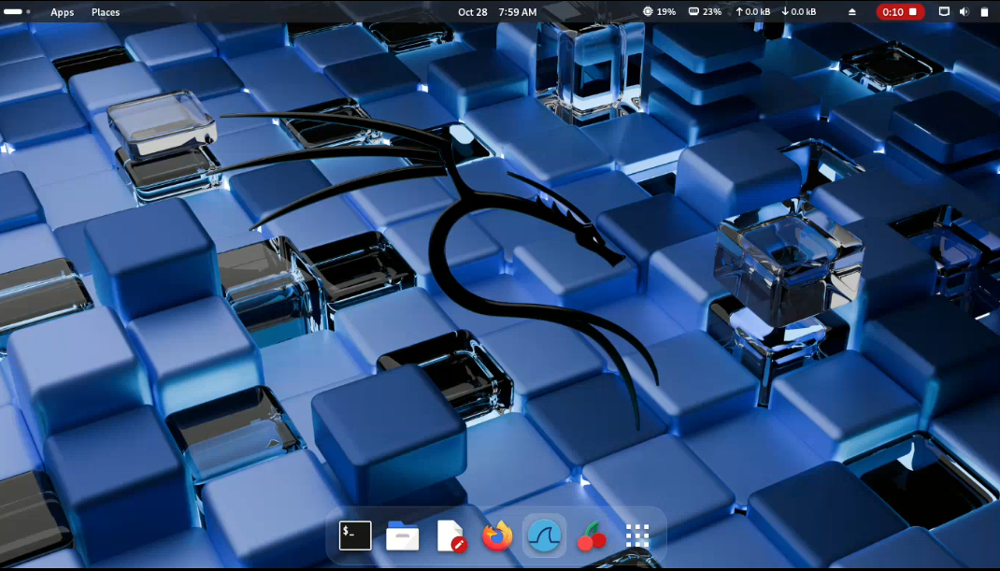
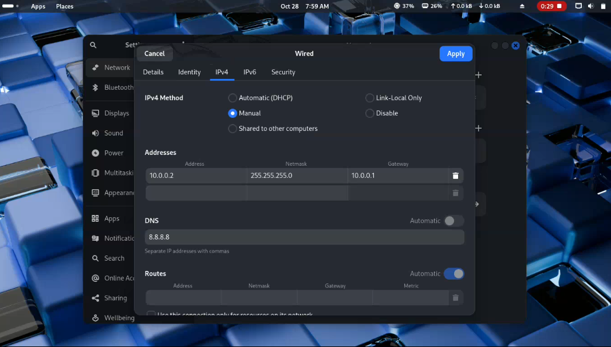
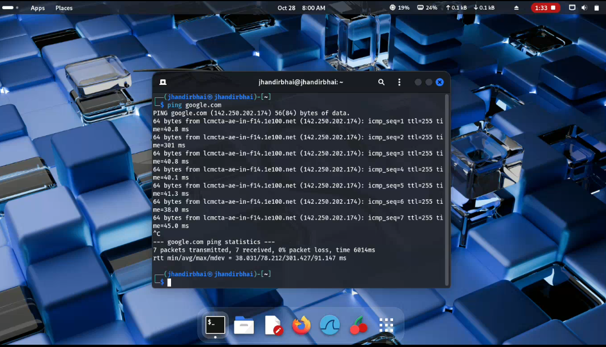
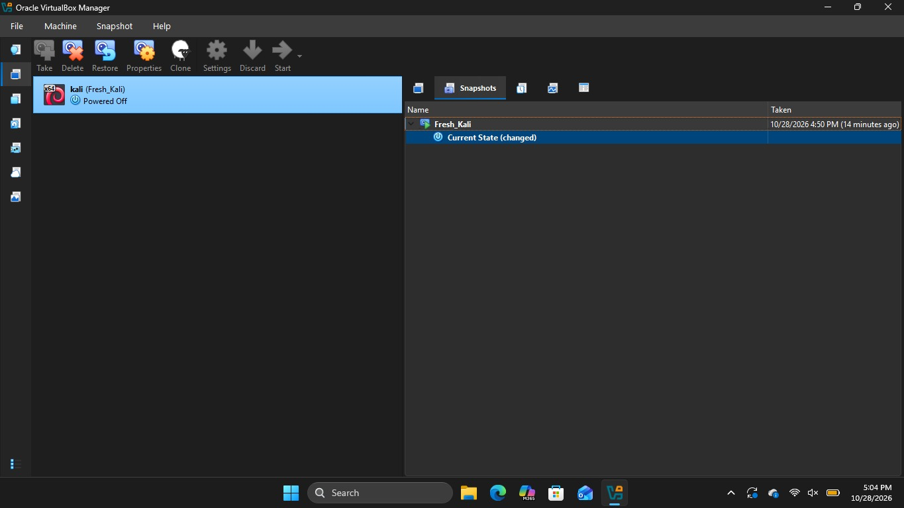

<h1 align="center">🔐 Cybersecurity Lab Environment Setup</h1>

<p align="center">
  <b>Building an isolated virtual lab for penetration testing and ethical hacking practice</b>
</p>

<p align="center">
  
  
  
  
  
  
  
  
  
  
  
  
</p>

---

## 📌 Project Overview

This project is about building a **virtual cybersecurity and penetration-testing laboratory** with VirtualBox and Kali Linux.

The lab gives me a safe, controlled space to practice security tools, network scanning, and ethical hacking techniques without putting my main system at risk. Every machine lives inside VirtualBox on a private NAT Network, so experiments stay contained.



---

## 🎯 Project Objectives

- Install and configure VirtualBox
- Import and configure a Kali Linux virtual machine
- Create a private NAT Network for the lab
- Configure and verify Kali's network settings
- Test network connectivity and DNS resolution
- Create a clean VM snapshot for recovery
- Document the full process on GitHub

---

## 🧰 Tools Used

| Tool | Purpose |
|------|---------|
| 7-Zip | Extracting the Kali Linux VM image |
| VirtualBox | Virtualization platform |
| Kali Linux | Penetration testing operating system |

---

## 🗺️ Lab Network Design

| Setting | Value |
|---------|-------|
| Host OS | Windows |
| Virtualization | Oracle VirtualBox |
| Network type | NAT Network (custom) |
| Network name | NatNetwork |
| IPv4 prefix | 10.0.0.0/24 |
| DHCP server | Disabled (manual IPs) |
| Kali Linux IP | 10.0.0.2 |
| Subnet mask | 255.255.255.0 |
| Gateway | 10.0.0.1 |
| DNS | 8.8.8.8 |

---

## 🚀 Implementation Steps

### Step 1: Install VirtualBox and Import Kali Linux
Installed VirtualBox, extracted the Kali Linux VM image with 7-Zip, and imported it into VirtualBox as the `kali` virtual machine.

### Step 2: Create the NAT Network
Created a private NAT Network named **NatNetwork** with the prefix `10.0.0.0/24`. DHCP is disabled, so each VM gets a manual IP address.



### Step 3: Start Kali Linux
Attached the Kali VM to the NAT Network and booted it successfully.



### Step 4: Configure the Network Settings
Set the IPv4 method to **Manual** in Kali's wired connection settings:

| Field | Value |
|-------|-------|
| Address | 10.0.0.2 |
| Netmask | 255.255.255.0 |
| Gateway | 10.0.0.1 |
| DNS | 8.8.8.8 |



### Step 5: Test Connectivity and DNS Resolution
Verified internet access and DNS by pinging google.com from the Kali terminal.

```bash
ping google.com
```

The test finished with 7 packets sent, 7 received, and 0% packet loss, which confirms both connectivity and DNS resolution work.



### Step 6: Create a Clean VM Snapshot
Took a snapshot named **Fresh_Kali** of the working VM, giving me a known-good restore point.



---

## 🧩 Problems Faced & Solutions

### Problem 1: Network Delay After IP Configuration
The connection was slow to come up after the manual IP settings were applied. Setting the duplicate address detection timeout to zero fixed it:

```bash
sudo nmcli connection modify "Wired connection 1" ipv4.dad-timeout 0
```

The network connection was then restarted and connectivity tested again.

> **Note:** Interface and connection names differ between systems. Run `nmcli connection show` first to find your actual connection name before using any nmcli command.

### Problem 2: VirtualBox VT-x / Virtualization Error
The VM failed to start because hardware virtualization was disabled in the BIOS/UEFI.

**Solution:**
1. Restart the computer and enter the BIOS/UEFI settings
2. Enable Intel VT-x / hardware virtualization
3. Save the configuration and restart
4. Start the Kali VM again

After enabling virtualization, the VM started successfully.

---

## 💡 What I Learned

**1. NAT vs NAT Network**
A standard NAT adapter gives each VM its own isolated outbound connection. A NAT Network lets multiple VMs share one private network and talk to each other while still reaching the internet through address translation, which is exactly what a multi-machine lab needs.

**2. Virtual Machine Networking**
How VirtualBox network adapters connect VMs to different network types, and how that choice affects communication between machines.

**3. Static IP Configuration**
How to configure and verify an IPv4 address, subnet mask, gateway, and DNS server in Kali Linux.

**4. VM Snapshots**
A clean snapshot should be taken before any risky or experimental work, so there is always a known-good point to roll back to.

**5. Documentation**
Recording commands, configurations, screenshots, problems, and fixes is a core part of any professional cybersecurity project.

---

## 🔐 Security & Ethical Use

This lab is built **strictly for educational purposes**. All testing stays inside this isolated environment or on systems I own or have explicit permission to test.

---

## 🔗 Tools & Resources

- **7-Zip:** https://7-zip.org/download.html
- **VirtualBox:** https://virtualbox.org/wiki/Downloads
- **Kali Linux:** https://kali.org/get-kali

---

## 👤 Author

**Muhammad Anas Ishfaq**
Cybersecurity Student | Batch B084

LinkedIn: https://www.linkedin.com/in/anasishfaqcyber

---

## 📌 Project Information

| | |
|---|---|
| **Program Name** | Cybersecurity at Networkwalks |
| **Batch** | B084 |
| **Week** | 01 |
| **Project** | Cybersecurity & Pentesting Lab Setup |
| **Instructor** | Waqas Karim (CCIE) |
| **Repository** | GitHub |
